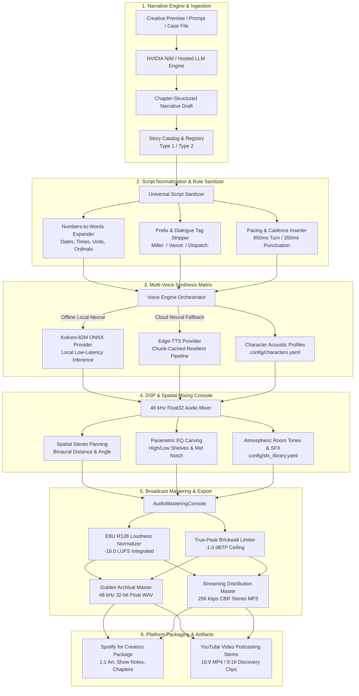

# Caydence 🎙️✨
### Industrial Cinematic Audio Drama & Spatial Narration Engine

[](https://www.gnu.org/licenses/agpl-3.0)
[](https://www.python.org/downloads/)
[](https://tech.ebu.ch/loudness)
[](https://creators.spotify.com)
[](https://github.com/TheClairvoyantBeing/Caydence/pkgs/container/caydence)
[](https://github.com/TheClairvoyantBeing/Caydence/releases)

---

## 📖 Overview

**Caydence** is a cinema-grade autonomous audio drama, narration, and podcast production system. Designed for solo creators, production studios, and automated archival channels, Caydence bridges the gap between **generative long-form narrative scriptwriting** and **studio-mastered multi-character spatial audio synthesis**.

From a raw narrative premise or case prompt, Caydence autonomously drafts retention-optimized 50+ minute scripts, normalizes prose to strict broadcast speech rules (e.g., numbers expanded to words, dialogue cues stripped, natural speaker pause pacing), and synthesizes multi-voice audio rendered into **EBU R128 mastered 48 kHz 32-bit float WAVs** and **256 kbps CBR MP3s** ready for immediate Spotify and YouTube syndication.

---

## 🏛️ System Architecture



### Architectural Breakdown:

1. **Narrative Engine & Ingestion**:
   - Leverages high-throughput LLM architectures (hosted via NVIDIA NIM, e.g., Llama 3.2 / Nemotron) to construct multi-chapter, suspense-driven storytelling scripts with retention hooks and mid-roll anchors.
2. **Script Normalization & Rule Sanitizer**:
   - Enforces strict broadcast spoken-word rules: all numbers, timestamps (`14:43:01` → *fourteen forty-three oh-one*), distances, and Roman numerals are expanded phonetically into words. Dialogue actor prefixes (`Miller:`, `Vance:`) are stripped so narrators never pronounce script headings out loud.
3. **Multi-Voice Synthesis Matrix**:
   - Agnostic voice provider abstraction supporting both high-speed offline local neural synthesis (**Kokoro-82M ONNX Runtime**) and high-fidelity cloud neural synthesis (**Edge-TTS**) with exponential backoff retry and chunk-level caching.
4. **DSP & Spatial Mixing Console**:
   - 48 kHz 32-bit floating-point mixing engine. Applies character-specific parametric EQ carving (reducing frequency clashes), binaural stereo positioning, and dynamic cue-sheet SFX placement.
5. **Broadcast Mastering Engine**:
   - Calibrated to international broadcast standards: **ITU-R BS.1770-4 / EBU R128**. Normalizes loudness to **-16.0 LUFS** (±0.5 LUFS) with a **-1.0 dBTP** true-peak ceiling, preventing digital clipping when streaming services transcode to lossy mobile codecs.
6. **Platform Distribution & Packaging**:
   - Generates compliant metadata, episode descriptions, chapter cues, and visual asset checklists for Spotify for Creators and YouTube Podcasting.

---

## ⚡ Key Features

* **🎭 Multi-Character Dramatic Voice Assignment**: Define cast members, vocal age profiles, pan positions, and EQ profiles in `config/characters.yaml`.
* **🧠 Autonomous 2-Stage Pipeline**: Foreground scriptwriter drafts upcoming chapters while a background consumer thread synthesizes and stitches audio in parallel.
* **🛡️ Zero-Dropout Resilient Synthesis**: Chunks large manuscripts (<1800 characters) at grammatical sentence boundaries with isolated scratch caching and automated retry backoff.
* **📏 Strict Audio Standards**: Full compliance with the *Universal Production Rules* (see `system_rules/audio_production_rules.md`).
* **📦 Complete Packaging & Delivery**:
  - Python package (`pip install .` / Wheel)
  - Multi-platform Docker container published to GitHub Container Registry (GHCR)
  - Standalone single-file Windows executable (`caydence-windows-x64.exe`) via PyInstaller

---

## 🚀 Quickstart

### 1. Installation

#### From Source (Recommended for Developers):
```bash
# Clone the repository
git clone https://github.com/TheClairvoyantBeing/Caydence.git
cd Caydence

# Create and activate Python virtual environment
python -m venv venv
# Windows:
.\venv\Scripts\activate
# Linux/macOS:
source venv/bin/activate

# Install system dependencies (ffmpeg and libsndfile)
# Debian/Ubuntu: sudo apt-get install -y ffmpeg libsndfile1
# macOS: brew install ffmpeg libsndfile
# Windows: ensure ffmpeg is in your system PATH

# Install Caydence
pip install -e .
```

#### Via Docker:
```bash
docker pull ghcr.io/theclairvoyantbeing/caydence:latest
docker run --rm -it ghcr.io/theclairvoyantbeing/caydence:latest --help
```

---

### 2. Configuration (`.env`)

Copy `.env.example` to `.env` and supply your API keys:
```bash
cp .env.example .env
```
```env
# NVIDIA NIM API Key (Required for story script generation)
# Get your free developer key at: https://build.nvidia.com/
NVIDIA_API_KEY=nvapi-your-key-here

# Preferred story drafting model
NVIDIA_MODEL=meta/llama-3.2-11b-vision-instruct

# Optional: Path to Kokoro ONNX model weights (if using offline local voice engine)
# KOKORO_ONNX_PATH=models/kokoro/kokoro-v1.0.onnx
# KOKORO_VOICES_PATH=models/kokoro/voices-v1.0.bin
```

---

## 💻 CLI Usage

Caydence provides two primary command-line interfaces:

### Interactive & Single-Story Narration (`caydence`)

```bash
# Interactive mode (launches CLI wizard)
caydence

# Automated single-story run (Script generation + Speech synthesis + Mastering)
caydence --mode auto --topic "The Unopened Vault of Room 104" --gender male

# Script drafting only (Saves story.md and story.txt without rendering audio)
caydence --mode story --topic "The Wheeler Highrise Protocol"

# TTS Narration only of an existing script
caydence --mode tts --input path/to/story.txt --output path/to/output.wav
```

### Industrial Batch Pipeline (`caydence-pipeline`)

```bash
# Run batch production for Type 1 stories 1 through 5
caydence-pipeline --type "Type 1" --start 1 --end 5

# Produce multi-character audio dramas (Type 2)
caydence-pipeline --type "Type 2" --start 1 --end 3

# Specify custom output directory
caydence-pipeline --type "Type 1" --start 1 --end 10 --output-dir "D:/Productions/Season1"
```

---

## 📁 Repository Structure

```
Caydence/
├── .agents/
│   └── rules/                  # Active AI agent rules for IDE pair-programming
│       └── audio_production_rules.md
├── .github/
│   └── workflows/
│       └── package-release.yml # Automated CI/CD, wheel build, GHCR Docker, and Windows EXE
├── assets/
│   └── voices/LICENSES.md      # Acoustic sample attribution and license metadata
├── modules/                    # Core Python Modules Package
│   ├── __init__.py             # Version and public API exposure
│   ├── __main__.py             # python -m caydence entrypoint
│   ├── cli.py                  # Unified CLI parser and handlers
│   ├── audio_engine.py         # 48kHz float32 audio buffers, DSP, and EBU R128 console
│   ├── story_engine.py         # NVIDIA NIM / LLM storytelling client
│   ├── voice_engine.py         # Kokoro-ONNX & Edge-TTS multi-voice providers
│   ├── sound_design.py         # Atmospheric drone generation, transitions, and audio cues
│   ├── spatial_mix.py          # Binaural stereo panning and spatial sound placement
│   ├── cue_sheet.py            # Timed audio drama cue sheet parsing
│   ├── utils.py                # Text normalization, number expansion, and file utilities
│   └── pipeline/               # 2-Stage Industrial Pipeline
│       ├── catalog.py          # Story taxonomic classification & metadata registry
│       ├── scriptwriter.py     # Resilient multi-chapter LLM script generator
│       ├── synthesizer.py      # Chunked neural TTS synthesis & broadcast mastering
│       └── orchestrator.py     # Pipelined producer-consumer thread orchestrator
├── config/
│   ├── characters.yaml         # Multi-character cast definitions & EQ profiles
│   └── sfx_library.yaml        # Audio drama sound effect library index
├── docs/
│   ├── SPOTIFY_CREATOR_PLAYBOOK.md   # Complete Spotify ingestion, show art, and growth guide
│   └── YOUTUBE_STORY_FRAMEWORKS.md   # 10 core storytelling frameworks for retention
├── system_rules/
│   └── audio_production_rules.md     # Universal master rules (Numbers in words, LUFS, etc.)
├── tests/                      # Automated unit and QA regression suite
│   ├── test_audio_drama_qa.py  # 48 kHz mastering, true-peak, and DSP assertions
│   ├── test_packaging.py       # Package imports, version, and CLI interface tests
│   └── test_vox_clone.py       # Pacing, chunking, and text cleaner validation
├── Dockerfile                  # Container definition for GitHub Packages (GHCR)
├── caydence_entry.py           # Standalone launcher for PyInstaller
├── caydence_windows.spec       # Windows x64 PyInstaller build specification
├── pyproject.toml              # PEP 517 / PEP 621 package metadata and dependencies
├── requirements.txt            # Frozen production requirements
├── LICENSE                     # GNU Affero General Public License v3.0 (Copyleft)
└── README.md                   # System documentation and architectural manual
```

---

## 📜 Copyleft License & Open Source Commitment

This project is licensed under the **GNU Affero General Public License v3.0 (AGPL-3.0)**.

> [!IMPORTANT]
> **Share-Alike / Copyleft Notice**:  
> You are free to use, modify, run, and distribute Caydence for personal, commercial, or creative productions. However, if you modify Caydence, build derivative engines, or deploy it as a network-accessible service, **you must make your modified source code available to the community under the same AGPL-3.0 license**.

See the full text in [`LICENSE`](LICENSE).

---

## 🙏 Mentions & Acknowledgements

The development of **Caydence** stands on the shoulders of remarkable open-source projects, research initiatives, and audio engineering pioneers:

* **[Kokoro-82M by Hexgrad](https://huggingface.co/hexgrad/Kokoro-82M)** & **Kokoro-ONNX**: For pioneering ultra-lightweight, expressive, high-speed local neural speech synthesis.
* **[NVIDIA NIM & AI Foundation Models](https://build.nvidia.com/)**: For high-throughput hosted Llama 3.2 and Nemotron inference powering dynamic long-form storytelling.
* **[Edge-TTS](https://github.com/rany2/edge-tts)**: For high-quality, resilient cloud neural text-to-speech accessible to independent creators worldwide.
* **[Spotify Audio Engineering & Pedalboard](https://github.com/spotify/pedalboard)**: For high-performance Python spatial DSP, acoustic filters, and spatial audio mastering tools.
* **[PyLoudnorm (Christian Steinmetz)](https://github.com/csteinmetz1/pyloudnorm)**: For the definitive ITU-R BS.1770-4 / EBU R128 loudness measurement and normalization toolkit.
* **[FFmpeg Project](https://ffmpeg.org/)** & **[libsndfile](https://github.com/libsndfile/libsndfile)**: The irreplaceable backbone of professional broadcast audio transcoding.
* **Spotify for Creators & Podcast Communities**: For ongoing research into audience retention, chapter indexing, and audio drama discoverability.
* **The Internet Fiction, NoSleep & Creepypasta Communities**: For inventing modern serialized digital audio drama storytelling.
