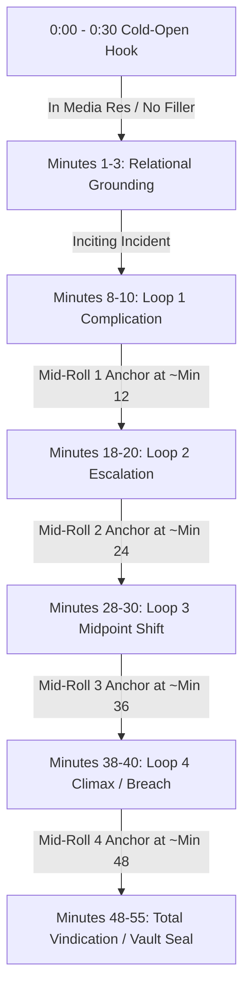

# YouTube Storytelling Frameworks, Production Blueprint & Creator Directives
# Comprehensive Knowledge Base & Industrial Audio Operations Architecture

This master document compiles all strategic storytelling architecture, algorithmic audience retention mechanics, YouTube platform governance, multi-tier audio engineering, and creator directives governing the **Caydence** industrial production pipeline.

---

## 1. Core Creator Directives & Strict Narrative Constraints

1. **Absolute Sci-Fi Ban:**
   * **STRICTLY NO SCI-FI MOVIES OR THEMES.** No aliens, futuristic space travel, cyberpunk technology, or interstellar plots.
   * All narratives must be strictly grounded in:
     * Human psychological drama & social vindication.
     * Survival rules, isolation horror, and situational protocols.
     * Archival investigative case files, analog anomalies, and unlisted asset containment.
     * True crime, forensic paper trails, and cold cases.
     * Historical reality and institutional cover-ups.
     * Syndicate hierarchy and boardroom power struggles.

2. **Spoken Narration Hygiene & Anti-Beautification Directives:**
   * **Zero Spoken Metadata or Chapter/Act Headers:**
     * The TTS narration must **never speak chapter numbers, act banners, or scene headers aloud** (e.g., never read *"Act 1: The Toast in the Sommelier Vault"*, *"Chapter 1: Archival Intake"*, or *"Part 2"*).
     * Narration opens *in media res* directly into the scene and transitions organically between narrative sections with natural breath pauses and zero metadata interruption.
   * **Grounded Prose (Anti-Purple Prose):**
     * Avoid artificial embellishments, melodramatic filler, and repetitive flowery metaphors.
     * Ground the narrative in crisp forensic details, concrete dialogue in quotes, tangible physical actions, and natural conversational modules.

3. **Duration & Word-Count Minimums by Tier:**
   * **Type 1 (Reddit / Social Confessions — One-Shot):** **50+ Minutes MINIMUM** (7,500 – 10,500 words across 5 extended chapters). Single self-contained episode with total vindication.
   * **Type 2 (Survival Rules & Situational Protocols):** **50+ Minutes MINIMUM** (7,000 – 11,000 words across 5 structured rule-survival chapters).
   * **Type 3 (DUA Archival Investigative Case Files):** **50+ Minutes MINIMUM** (7,000 – 11,500 words across 5 forensic investigative chapters).

---

## 2. Three-Tier Production Taxonomy

All story generation and audio rendering is organized into a deterministic three-tier hierarchy:

| Tier | Category | Format & Scope | Target Output Directory | Deliverable Artifacts | Target Runtime |
| :--- | :--- | :--- | :--- | :--- | :--- |
| **Type 1** | **Reddit / Social Confessions** | Betrayal, revenge, silent exits, boardroom takedowns, and inheritance vindication. | `Theoutput/Type 1/<id>-<slug>/` | `narration.wav`<br>`story.txt`<br>`story.md` | **50+ Minutes** (7,000–12,000 words) |
| **Type 2** | **Survival Rules & Protocols** | Bizarre survival protocols, graveyard shifts, isolated caretaking, and breach containment. | `Theoutput/Type 2/<id>-<slug>/` | `narration.wav`<br>`story.txt`<br>`story.md` | **50+ Minutes** (7,000–11,000 words) |
| **Type 3** | **DUA Archival Case Files** | Department of Unlisted Assets: forensic audio logs, anomalous physical surveys, subterranean breaches, and vault seals. | `Theoutput/Type 3/<id>-<slug>/` | `narration.wav`<br>`story.txt`<br>`story.md` | **50+ to 90+ Minutes** (7,000–14,000 words) |

### Cleanliness & Deliverable Standard
Every output folder strictly contains only production-ready deliverables:
- `narration.wav`: Broadcast-mastered audio (48 kHz float32 stereo, -16 LUFS, -1 dBTP true peak).
- `story.txt`: Plain text script for teleprompters, subtitles, or offline reading.
- `story.md`: Beautifully formatted Markdown script with chapter breakdown and metadata header.
- *All intermediate render chunks, scratch MP3s, and temporary files are automatically pruned after mastering.*

---

## 3. Approved Voice Casting & Acoustic Parameters

To maintain listener comfort over long-form listening sessions (50 to 90+ minutes), Caydence uses a curated pool of neural voices tuned for warmth, clarity, and immersion:

### Approved Narrator Voice Pools
- **Female Leads:**
  - `en-US-JennyNeural` — Warm, expressive, highly engaging American female narrator.
  - `en-US-AnaNeural` — Soft, intimate, vulnerable, grounded atmosphere.
- **Male Leads:**
  - `en-US-BrianNeural` — Deep, resonant, late-night baritone storytelling voice.
  - `en-US-SteffanNeural` — Crisp, intense, dramatic close-mic delivery.
  - `en-CA-LiamNeural` — Balanced, measured, authoritative Canadian male narrator.

### Acoustic Tuning
- **Speech Rate:** `-8%` rate for calm, unhurried, natural storytelling modules.
- **Pitch Shift:** `-2Hz` pitch for grounded, warm vocal resonance.
- **Breath Injections:** 550ms breath-pauses injected at sentence and paragraph boundaries to eliminate robotic continuous delivery.
- **Gender Matching:** Automated protagonist gender detection alternates voice casting to maintain variety and matching perspective.

---

## 4. Master Broadcast & Acoustic Standards

All master audio generated by Caydence complies with strict international broadcast delivery specifications:

| Technical Metric | Specification | Compliance Rationale |
| :--- | :--- | :--- |
| **Sample Rate** | **48,000 Hz** | Studio master standard (eliminates 22.05 kHz lowpass truncation). |
| **Bit Depth** | **32-bit Float (IEEE 754)** | Zero quantization distortion, unlimited internal headroom. |
| **Channel Format** | **Stereo (2 Channels)** | True binaural and spatial stereo field depth. |
| **Integrated Loudness** | **-16.00 LUFS (±0.5 LUFS)** | EBU R128 / ITU-R BS.1770-4 broadcast compliance. |
| **Maximum True Peak** | **-1.00 dBTP** | Zero inter-sample clipping during YouTube AAC/Opus re-encoding. |
| **Subsonic Filter** | **25 Hz Highpass (Butterworth 2nd)** | Eliminates inaudible sub-bass rumble, DC bias, and HVAC thumps. |
| **High Frequency Range** | **Full >10 kHz Preserved** | Delivers crisp, transparent vocal transients. |

---

## 5. Algorithmic Retention Engineering (AVD Optimization)

On YouTube, long-form videos (50+ to 90+ minutes) are evaluated primarily by **Average View Duration (AVD)** and total session watch time. Retaining 35–45% of viewers on a 55-minute video delivers 20+ minutes of raw watch time, signaling the algorithm to aggressively push the video to home feeds and suggested bars.

To clear these algorithmic thresholds, scripts follow four structural laws:



### Law 1: The 30-Second Cold-Open Hook
* Over 55% of viewers abandon content in the first 60 seconds if boredom or filler occurs.
* **Execution:** **ZERO preamble.** No channel greetings (*"Welcome back"*), no filler intros (*"Hey Reddit, throwaway account here"*), and no spoken act titles.
* Open directly *in media res* at the instant of discovery, betrayal, or anomalous breach.

### Law 2: Nested Narrative Loops (Every 8–10 Minutes)
* To prevent listener fatigue, plotlines must never flatline simultaneously.
* As one secondary mystery or argument resolves, open an adjacent, higher-stakes complication *before* the first settles.

### Law 3: Mid-Roll Retention Anchors (Minutes ~12, ~24, ~36, ~48)
* YouTube places automated mid-roll ads roughly every 8–12 minutes.
* Build deliberate micro-climaxes and sudden reveals directly preceding these timestamps so listeners are invested to stay through ad breaks.

### Law 4: Decisive Cathartic Resolution
* In social drama and confession channels, the primary driver of satisfaction is **total vindication**.
* In survival rules and case files, the driver is **forensic closure and lingering atmospheric dread**.

---

## 6. Complete Master Inventory (All 26 Finished Audio Masterpieces)

### Type 2: Survival Rules & Protocols (11 Stories | 105,694 Words | 11.38 Hours | 14.65 GB)
1. `1-reddit-special-the-deed-in-the-wine-cellar`: 91.36 min | 14,497 words | 2,007 MB (Reddit Special)
2. `1-TheWheelerHighriseProtocol`: 43.21 min | 6,770 words | 949.5 MB | Narrator: Jenny (F)
3. `2-NightShiftAtStJudesWard4`: 45.45 min | 6,918 words | 998.6 MB | Narrator: Ana (F)
4. `3-TheBlackwoodTollwayBooth9`: 70.80 min | 10,832 words | 1,555.7 MB | Narrator: Steffan (M)
5. `4-TheTenantOfHeronPointLight`: 65.64 min | 10,564 words | 1,442.3 MB | Narrator: Liam (M)
6. `5-NightAuditorAtHotelVandermeer`: 53.23 min | 7,129 words | 1,169.5 MB | Narrator: Jenny (F)
7. `6-SubLevel3SecurityAtGreyfriarsArchive`: 54.94 min | 9,470 words | 1,207.1 MB | Narrator: Brian (M)
8. `7-CaretakerOfBlackthornOrchard`: 58.61 min | 9,768 words | 1,287.8 MB | Narrator: Brian (M)
9. `8-Platform0AtLancasterJunction`: 60.65 min | 9,733 words | 1,332.6 MB | Narrator: Jenny (F)
10. `9-TheNightWatchAtBellFoundry`: 61.73 min | 9,545 words | 1,356.3 MB | Narrator: Steffan (M)
11. `10-TheWinterCaretakerOfCampOakhaven`: 77.29 min | 10,468 words | 1,698.4 MB | Narrator: Ana (F)

### Type 3: DUA Archival Investigative Case Files (15 Stories | 143,851 Words | 16.84 Hours | 21.69 GB)
1. `1-Case401TheBlackwoodSinkhole`: 51.43 min | 7,234 words | 1,130.0 MB | Narrator: Brian (M)
2. `2-Case402TheUnrecordedRoom`: 76.55 min | 10,748 words | 1,682.0 MB | Narrator: Ana (F)
3. `3-Case403TheColdSpringWiretaps`: 63.85 min | 9,105 words | 1,402.9 MB | Narrator: Steffan (M)
4. `4-Case404TheWellOfSaintJude`: 93.39 min | 11,939 words | 2,052.1 MB | Narrator: Jenny (F)
5. `5-Case405TheMirrorInCell19`: 86.59 min | 13,614 words | 1,902.7 MB | Narrator: Liam (M)
6. `6-Case406TheVanishing415`: 72.34 min | 10,599 words | 1,589.4 MB | Narrator: Ana (F)
7. `7-Case407TheHollowForestSurvey`: 39.63 min | 5,901 words | 870.7 MB | Narrator: Brian (M)
8. `8-Case408The1974CivilBroadcast`: 69.99 min | 10,466 words | 1,538.0 MB | Narrator: Jenny (F)
9. `9-Case409TheWaxCylinderInquest`: 74.14 min | 10,949 words | 1,629.1 MB | Narrator: Steffan (M)
10. `10-Case410TheBreachAtSubBasement6`: 73.10 min | 10,782 words | 1,606.1 MB | Narrator: Liam (M)
11. `11-Case411TheUnmappedBeaconOfCapeDespair`: 79.43 min | 10,110 words | 1,745.4 MB | Narrator: Ana (F)
12. `12-Case412TheBlackwoodMicrofilmArchive`: 78.20 min | 11,291 words | 1,718.2 MB | Narrator: Brian (M)
13. `13-Case413TheSilentFrequencyOfTower9`: 53.11 min | 7,857 words | 1,166.9 MB | Narrator: Jenny (F)
14. `14-Case414The0300SubSurfaceSeismicRecord`: 44.72 min | 6,542 words | 982.7 MB | Narrator: Steffan (M)
15. `15-Case415TheUnopenedSafeOfRoom104`: 54.14 min | 6,714 words | 1,189.5 MB | Narrator: Ana (F)

---

## 7. CLI Production Commands

```powershell
# Inspect master catalog status across all tiers
python run_pipeline.py --status

# Inspect status filtered to a specific tier
python run_pipeline.py --status --type 2
python run_pipeline.py --status --type 3

# Run physical audio disk audit with soundfile
python run_pipeline.py --audit
python run_pipeline.py --audit --type 3

# Produce stories in batch
python run_pipeline.py --type 3 --start 1 --end 15

# Produce a specific single story
python run_pipeline.py --type 3 --story 11
```
